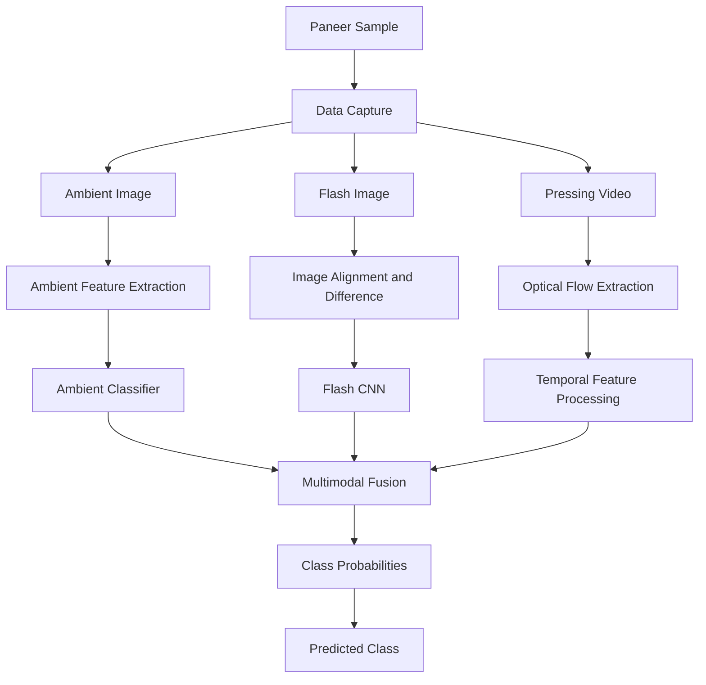
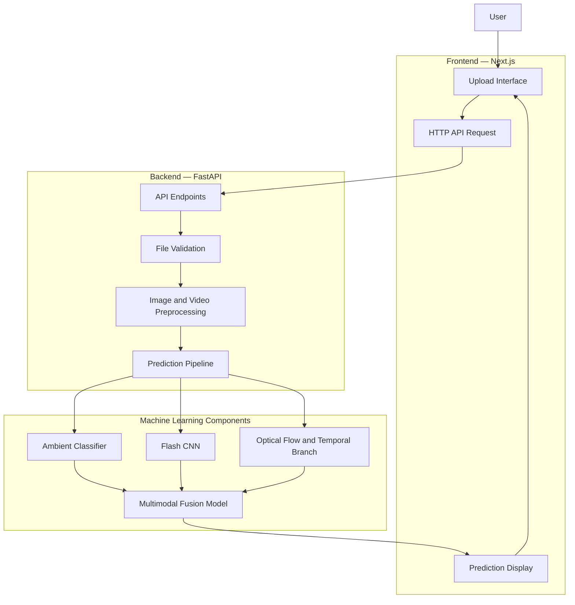
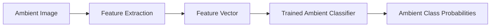
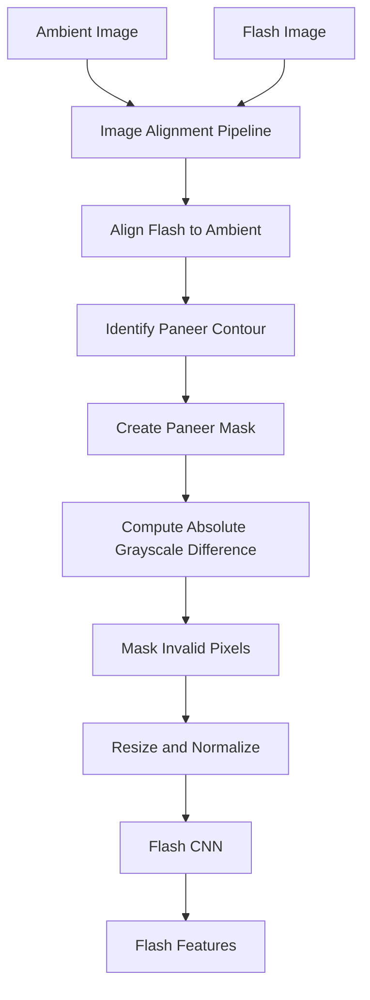
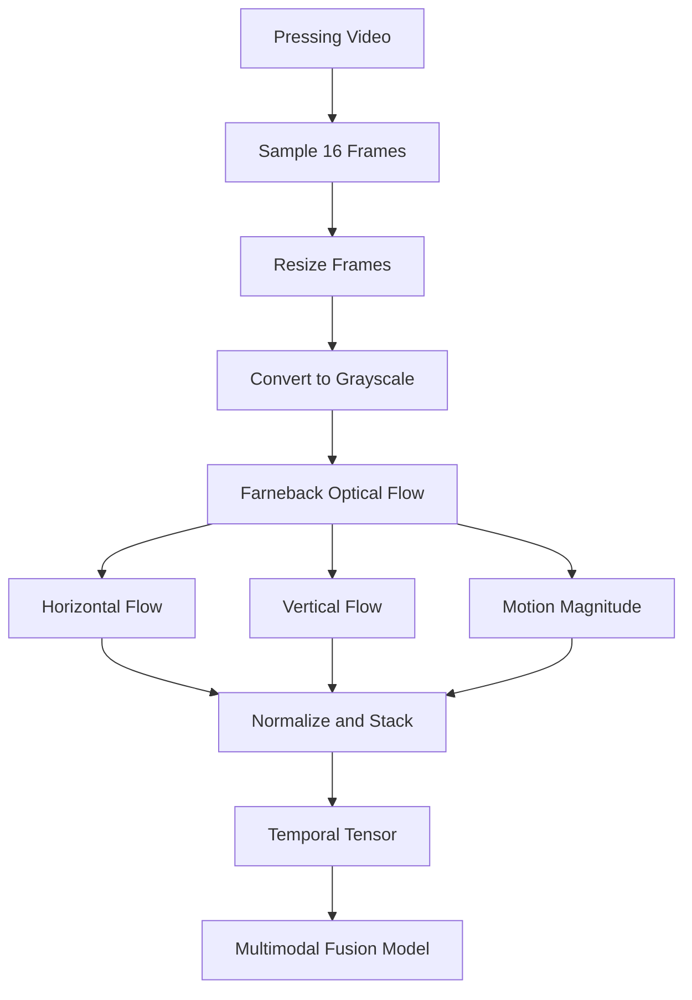
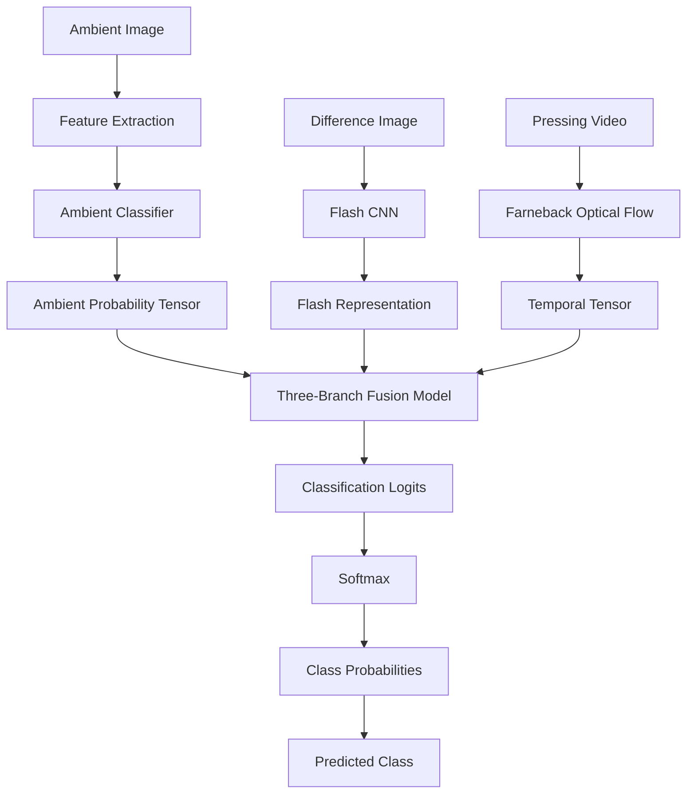
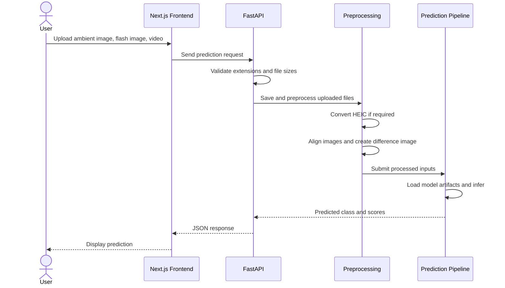
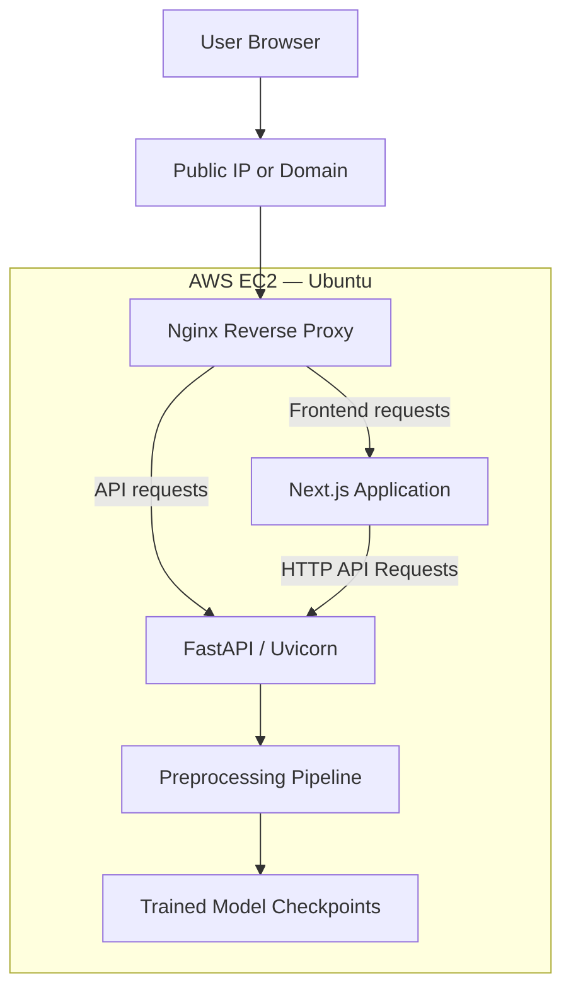

# AnalogueNet 🧀
### Multi-Modal Non-Destructive Quality Assessment and Analogue Detection in Dairy Products

AnalogueNet is an experimental computer vision and deep learning project designed to investigate whether paneer samples can be differentiated using **ambient images, flash images, and short pressing videos**.

The system combines spatial appearance information, flash-response differences, and temporal motion patterns into a multimodal classification pipeline. It provides an interface for uploading sample data and receiving model-generated predictions through a web application.

> **Disclaimer:** AnalogueNet is a research prototype. Its predictions are experimental and must not be interpreted as validated food-safety determinations.

---

## Table of Contents

- [Project Overview](#project-overview)
- [Problem Statement](#problem-statement)
- [Key Features](#key-features)
- [System Architecture](#system-architecture)
- [Multimodal ML Pipeline](#multimodal-ml-pipeline)
- [Image Preprocessing](#image-preprocessing)
- [Model Architecture](#model-architecture)
- [Prediction Workflow](#prediction-workflow)
- [Technology Stack](#technology-stack)
- [Repository Structure](#repository-structure)
- [Installation](#installation)
- [Running the Application](#running-the-application)
- [API Documentation](#api-documentation)
- [Deployment Architecture](#deployment-architecture)
- [Limitations and Future Work](#limitations-and-future-work)

---

## Project Overview

Traditional visual inspection relies heavily on appearance and human judgment. AnalogueNet explores a multimodal approach in which multiple observations of the same paneer sample are used to extract complementary information.

The current inference pipeline accepts three inputs:

1. **Ambient image:** An image captured without flash, used for appearance-based feature extraction.
2. **Flash image:** An image captured with flash, aligned with the ambient image to calculate a difference representation.
3. **Pressing video:** A short video processed into optical-flow features representing motion between frames.

These inputs are processed through separate computational branches and combined by a trained fusion model to produce a classification result.

### High-Level Workflow



---

## Problem Statement

The project investigates whether combining multiple image and video modalities can provide more informative representations of paneer samples than relying on a single visual input.

The central idea is that:

- Ambient images capture visible appearance.
- Flash images provide additional illumination-response information.
- Pressing videos provide temporal information about sample deformation and motion.

By combining these observations, AnalogueNet explores a multimodal classification strategy for experimental dairy-product quality assessment.

---

## Key Features

- **Multimodal inputs:** Ambient image, flash image, and pressing video.
- **Image alignment:** Aligns flash images with ambient images before comparison.
- **Paneer-region extraction:** Uses contour candidates and scoring to identify a suitable region.
- **Flash-difference representation:** Calculates pixel-wise absolute intensity differences.
- **Optical-flow processing:** Uses Farneback dense optical flow to represent frame-to-frame motion.
- **Machine learning inference:** Combines a traditional ambient classifier with neural network models.
- **REST API:** Exposes prediction functionality through FastAPI.
- **Web interface:** Uses Next.js, React, TypeScript, and Tailwind CSS.
- **Upload validation:** Checks supported file extensions and upload-size limits.

---

## System Architecture

AnalogueNet separates its web interface, API, preprocessing functions, and machine learning inference logic.



### Component Responsibilities

| Component | Responsibility |
|---|---|
| Next.js frontend | User interface and upload interactions |
| FastAPI | HTTP endpoints, request validation, and prediction orchestration |
| OpenCV | Image processing, alignment-related operations, and optical flow |
| Pillow and pillow-heif | Image loading and HEIC/HEIF conversion |
| Ambient classifier | Generates class probabilities from handcrafted image features |
| Flash CNN | Processes the flash-difference representation |
| Temporal processing | Extracts motion features from pressing videos |
| Fusion model | Combines multimodal representations and produces classification logits |

---

## Multimodal ML Pipeline

The current inference implementation is organized around three branches.

### 1. Ambient Image Branch

The ambient image is processed using the feature extraction function in `baseline_model.py`.

The extracted feature vector is passed to a trained classifier, which produces class probabilities.



### 2. Flash-Difference Branch

The ambient and flash images are aligned and compared to generate a difference image. The resulting image is resized and normalized before being passed to the flash CNN.



The difference representation is calculated as:

\[
D(x,y)=|I_{\text{ambient}}(x,y)-I_{\text{flash}}(x,y)|
\]

Here, both images are compared after alignment and grayscale conversion. Pixels outside the selected paneer region and valid alignment area are set to zero.

The original image canvas is retained rather than cropping the sample before CNN resizing.

### 3. Temporal Branch

The pressing video is sampled into 16 frames. Consecutive frames are converted to grayscale and processed with Farneback dense optical flow.



For each pair of consecutive frames, the optical-flow algorithm estimates displacement in the horizontal and vertical directions.

The implementation creates three channels:

- Horizontal flow
- Vertical flow
- Flow magnitude

These channels are normalized and assembled into a tensor for inference.

---

## Model Architecture

The current prediction implementation in `predict.py` loads three trained artifacts:

- `ambient_logreg_v1.joblib`
- `flash_difference_cnn_v2.pth`
- `multimodal_fusion_v2.pth`

The fusion network is represented by `ThreeBranchFusionModel`, defined in `train_multimodal_fusion_v2.py`.

### Inference Architecture



The fusion model combines the ambient probability tensor, flash-image tensor, and optical-flow tensor.

Softmax converts the output logits into class probabilities.

The API returns:

- `predicted_class`
- `untreated_score`
- `starch_treated_score`

The model's output reflects its learned classification behavior. It does not establish that a food sample is safe to consume.

---

## Prediction Workflow

The FastAPI backend coordinates file uploads, preprocessing, and inference.



### Upload Constraints

The current `app.py` implementation defines the following limits:

| Input | Supported extensions | Maximum size |
|---|---|---:|
| Ambient/flash images | `.jpg`, `.jpeg`, `.png`, `.heic`, `.heif` | 15 MiB per image |
| Pressing videos | `.mov`, `.mp4`, `.avi`, `.m4v` | 150 MiB per video |

The API validates file extensions and rejects empty uploads and files exceeding the configured limits.

---

## Technology Stack

| Layer | Technologies |
|---|---|
| Frontend | Next.js, React, TypeScript, Tailwind CSS |
| Backend | Python, FastAPI, Uvicorn |
| Computer vision | OpenCV, Pillow, pillow-heif |
| Machine learning | PyTorch, scikit-learn, Joblib |
| Numerical computing | NumPy |
| Version control | Git and GitHub |
| Deployment target | AWS EC2 running Ubuntu |

---

## Repository Structure

```text
analogue-net/
├── app.py
├── predict.py
├── baseline_model.py
├── segment_paneer.py
├── flash_roi_pipeline.py
├── flash_preprocessing.py
├── preprocess_video.py
├── train_flash_cnn.py
├── train_multimodal_fusion.py
├── train_multimodal_fusion_v2.py
├── train_video_convlstm.py
├── train_vit.py
├── prepare_dataset.py
├── create_split.py
├── check_flash_quality.py
├── cnn_baseline.py
├── models/
│   ├── ambient_logreg_v1.joblib
│   ├── flash_difference_cnn_v2.pth
│   └── multimodal_fusion_v2.pth
├── frontend/
│   ├── app/
│   ├── public/
│   ├── package.json
│   ├── package-lock.json
│   └── next.config.ts
└── README.md
```

Additional model checkpoints and project files may be present in the repository.

---

## Installation

### Prerequisites

- Python 3
- Node.js and npm
- Git
- The trained model checkpoints required for inference

### 1. Clone the repository

```bash
git clone https://github.com/Tarun250506/analogue-net.git
cd analogue-net
```

### 2. Create a Python virtual environment

```bash
python3 -m venv .venv
source .venv/bin/activate
```

### 3. Install backend dependencies

Install the packages required by the application and its imported modules. For example:

```bash
python -m pip install --upgrade pip
python -m pip install \
  fastapi \
  "uvicorn[standard]" \
  python-multipart \
  numpy \
  opencv-python-headless \
  pillow \
  pillow-heif \
  joblib \
  scikit-learn \
  pandas \
  torch
```

The exact package versions should be pinned and tested before production deployment.

### 4. Install frontend dependencies

```bash
cd frontend
npm ci
```

Return to the repository root when you need to run backend commands:

```bash
cd ..
```

---

## Running the Application

### Start the FastAPI backend

From the project root, activate the virtual environment and run:

```bash
source .venv/bin/activate
uvicorn app:app --host 0.0.0.0 --port 8000
```

The API will listen on port `8000`.

For local testing, open:

```text
http://127.0.0.1:8000/docs
```

On an EC2 deployment, use the server's public IP or configured domain, provided the network and firewall rules permit access.

### Start the Next.js frontend

In a separate terminal:

```bash
cd frontend
npm run dev -- --hostname 0.0.0.0
```

The development server uses port `3000` by default.

For a production build:

```bash
npm run build
npm run start
```

Use a process manager and reverse proxy for a persistent deployment rather than relying on development servers.

---

## API Documentation

FastAPI automatically provides interactive API documentation.

When the backend is running, open:

```text
http://localhost:8000/docs
```

For remote deployment, replace `localhost` with the server's reachable hostname or IP.

The application supports image and video uploads through its API endpoints. Refer to the endpoint definitions in `app.py` for the exact request fields and response structure.

### CORS Configuration

The current backend configuration allows these frontend origins:

- `http://localhost:3000`
- `http://127.0.0.1:3000`

For deployment, configure the production frontend origin explicitly. Do not use an unrestricted wildcard origin when credentials or sensitive operations are involved.

---

## Deployment Architecture

AnalogueNet can be deployed on a single AWS EC2 instance, with the frontend and backend running as separate processes.



### Deployment Responsibilities

- **Nginx:** Routes web traffic to the appropriate application service.
- **Next.js:** Serves the user interface.
- **FastAPI/Uvicorn:** Handles upload requests and model inference.
- **Model files:** Store the trained artifacts required for predictions.
- **EC2:** Provides the compute environment for the application.

For a production setup, expose ports `80` and `443` publicly and keep application ports such as `3000` and `8000` private behind Nginx. Configure HTTPS with a valid certificate before handling real user traffic.

---

## Limitations and Future Work

### Current limitations

- The project is experimental and requires further independent validation.
- Predictions depend on image quality, lighting, alignment, and video capture conditions.
- Model outputs are not equivalent to laboratory-confirmed adulteration results.
- The current inference implementation loads model artifacts through its prediction pipeline; loading them once at application startup could improve latency.
- Model accuracy and generalization should be evaluated on held-out samples and external datasets.

### Future work

- Expand the dataset across more sample types, capture devices, and environmental conditions.
- Evaluate calibration, sensitivity, specificity, precision, and recall.
- Compare individual modality performance against multimodal fusion.
- Improve preprocessing robustness under varied lighting and background conditions.
- Add automated testing and model-version tracking.
- Containerize the application and establish reproducible deployment workflows.
- Add structured logging, monitoring, and production error handling.

---

## Research and Responsible Use

AnalogueNet is intended for research into multimodal computer vision and experimental dairy-product classification.

Its predictions should not replace laboratory analysis, regulatory testing, or qualified food-safety assessment.

---

## Author

**Tarun Vijan**

Project: **AnalogueNet — Multi-Modal Non-Destructive Quality Assessment and Analogue Detection in Dairy Products**
